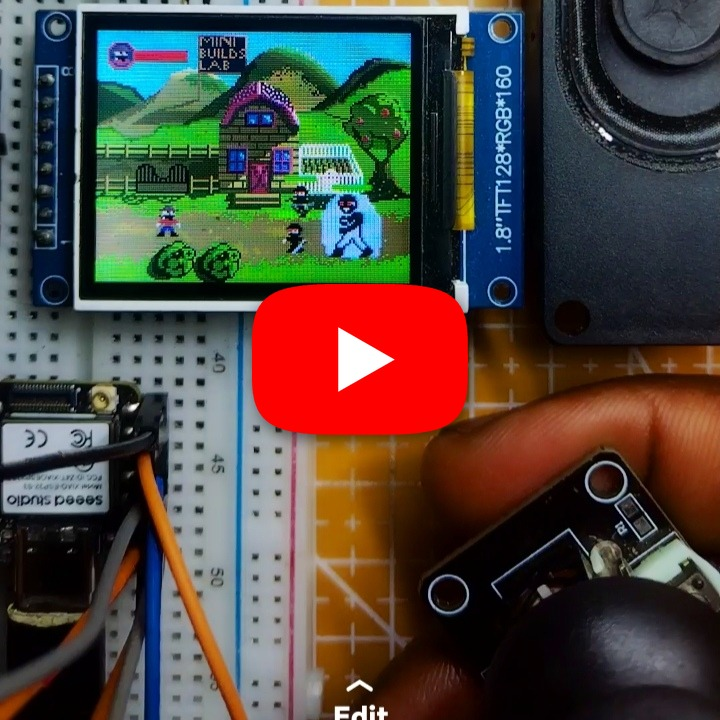
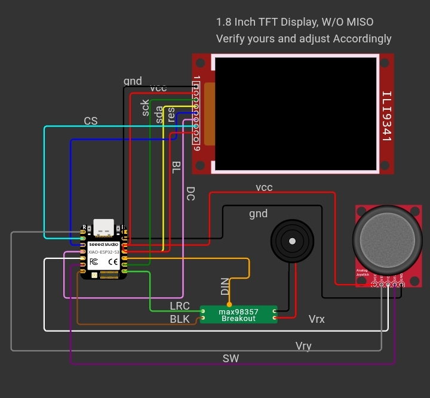

# DIY Console Open World Game on ESP32-S3

A compact open-world action game for the ESP32-S3 with a DIY handheld console layout, a TFT display, joystick controls, button-based combat, enemy AI, and built-in sound effects.

## Demo

https://youtube.com/shorts/Ot62HYaMtuk?si=xbsjx3Xgc9jipoXL

## Features

- Open-world exploration and scrolling map
- Sword combat with attack combos and hit detection
- Enemy wave logic with multiple enemy types
- Shooter-style ranged enemies and projectile combat
- Health bars, HUD elements, and game-over state
- ESP32-S3 audio output using I2S
- Lightweight sprite rendering for a small TFT display

## Hardware

- ESP32-S3 development board
- ST7735 160x128 TFT display
- Analog joystick
- Buttons for action / sword input
- I2S speaker or buzzer
- 3.3V power source and common ground

## Wiring

| Component | Connection |
|---|---|
| TFT CS | D1 |
| TFT RST | D2 |
| TFT DC | D3 |
| I2S BCLK | D6 |
| I2S LRC | D7 |
| I2S DIN | D9 |
| Joystick X | D0 |
| Joystick Y | D4 |
| Action button | D5 |

Connect the display, audio output, joystick, and buttons to the board using the wiring diagram above. Ensure the power rails and ground are shared correctly before uploading.

## Controls

- Move: joystick
- Attack / sword: button press
- Combo follow-up: quick repeated button presses
- Restart after game over: hold the action button after defeat

## Source

Open [`cow_boy.ino`](./cow_boy.ino) in the Arduino IDE or PlatformIO project environment. Include the required asset files in the same folder, select your ESP32-S3 board and port, then upload.

## Notes

The project uses sprite data and generated sound effect tables embedded in the source project files. Adjust pin mappings to suit your DIY console layout if necessary.
