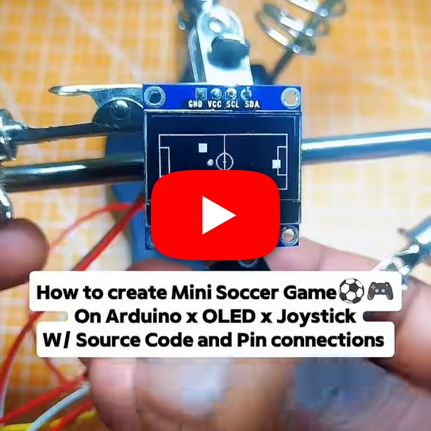

# Pixel Soccer

A pixel-art soccer simulation with arcade-style gameplay for a microcontroller.

## Demo

https://youtube.com/shorts/REPLACE_WITH_PIXEL_SOCCER_VIDEO_ID

## Hardware

- Arduino-compatible board or microcontroller
- Display used by the sketch
- Directional buttons or joystick
- Optional buzzer

## Wiring

Connect the display and controls according to the pin definitions in `Source-code`. Provide shared power and ground, and verify the display interface before uploading.

## Source

Open [`Source-code`](./Source-code) in the Arduino IDE, select the compatible board and port, and upload.
