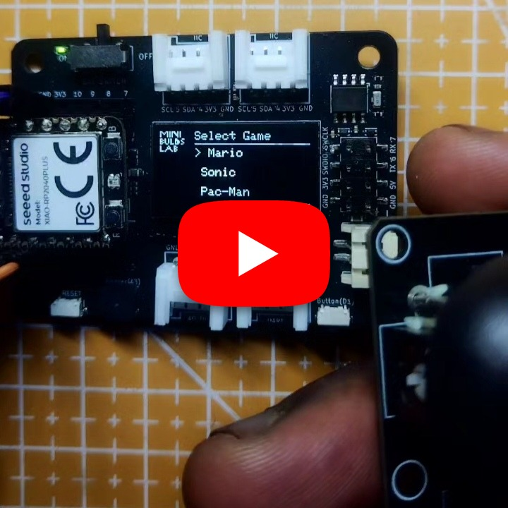

# XIAO RP2040 Console

A compact handheld retro-gaming console built around the Seeed XIAO RP2040. This project brings together multiple classic arcade-inspired games in one portable device, including Mario-style platforming, Sonic-style action, Pac-Man-inspired maze gameplay, and other lightweight retro experiences.

## Demo

https://youtube.com/shorts/REPLACE_WITH_RP2040_VIDEO_ID

## Features

- Seeed XIAO RP2040-based handheld console design
- Built-in joystick controls for navigation and movement
- Multi-game arcade-style library in one firmware build
- Includes Mario-inspired, Sonic-inspired, Pac-Man-inspired, and other retro games
- Small-form portable design for a DIY gaming console
- OLED display output with fast, lightweight game logic
- Simple Arduino/PlatformIO-style firmware development flow

## Hardware

- Seeed XIAO RP2040
- 128x64 OLED display
- Joystick module
- Buttons for A/B/menu/navigation
- Optional buzzer or speaker
- Battery pack and power switch (optional for portable use)

## Wiring

Connect the display, joystick, buttons, and audio output to the XIAO RP2040 according to the pin definitions in `xiao_rp2040_console.ino`.

| Component | Connection |
|---|---|
| OLED SDA | XIAO D0 / SDA |
| OLED SCL | XIAO D1 / SCL |
| Joystick X | Analog input |
| Joystick Y | Analog input |
| Joystick Button | Digital input |
| Buttons | Digital inputs |
| Buzzer / Speaker | PWM-capable GPIO |
| GND | Common ground |
| 3V3 / 5V | Power as required by your display/module |

> The exact pin mapping may vary depending on your wiring and hardware layout. Confirm the assignments in the sketch before uploading.

## Source

Open [`xiao_rp2040_console.ino`](./xiao_rp2040_console.ino) in the Arduino IDE, select the correct board and port for your XIAO RP2040, install any required libraries, and upload the sketch.

## Notes

This project is designed for a DIY portable handheld setup and is intended for educational and hobby experimentation. It demonstrates how to fit multiple simple retro-game mechanics onto a compact microcontroller platform while preserving responsive controls and a small display footprint.
