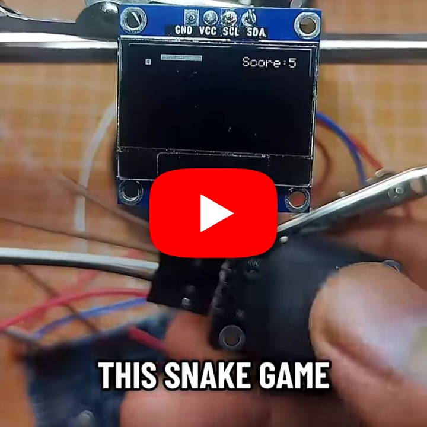
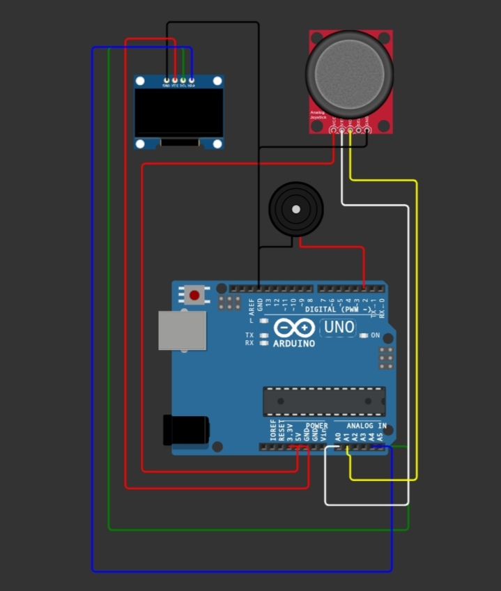

# Snake Game with OLED

)

A classic Snake game for Arduino/ESP32 with SSD1306 OLED display support and joystick controls.

## Demo

https://youtube.com/shorts/iePouueaKYo?si=wLm_RsPmg80rKM7t

## Hardware

- Arduino-compatible board or ESP32
- SSD1306 128x64 I2C OLED
- Two-axis analog joystick
- Optional buzzer, if enabled by the sketch

## Wiring

| Component | Pin |
|---|---|
| OLED SDA | board SDA |
| OLED SCL | board SCL |
| Joystick X | A0 |
| Joystick Y | A1 |
| Buzzer (optional) | 2 |

## Source

Open [`Source-code`](./Source-code) in the Arduino IDE, install the required OLED libraries, select the board and port, and upload.
