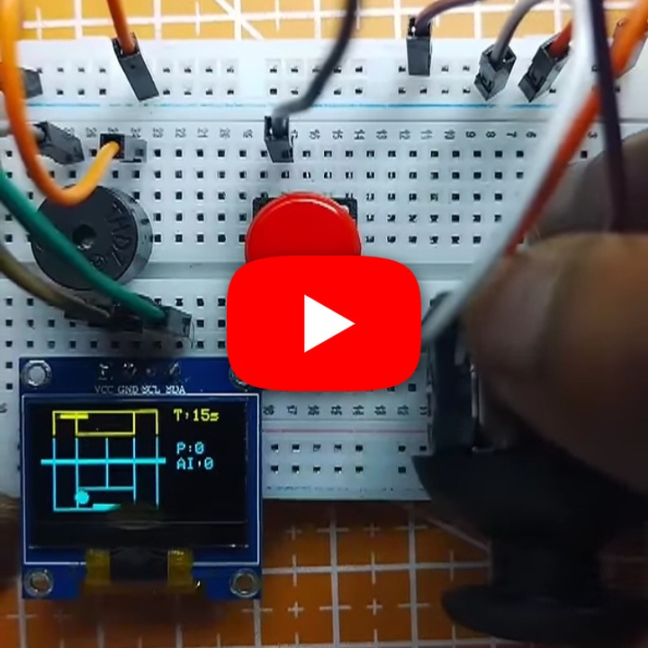
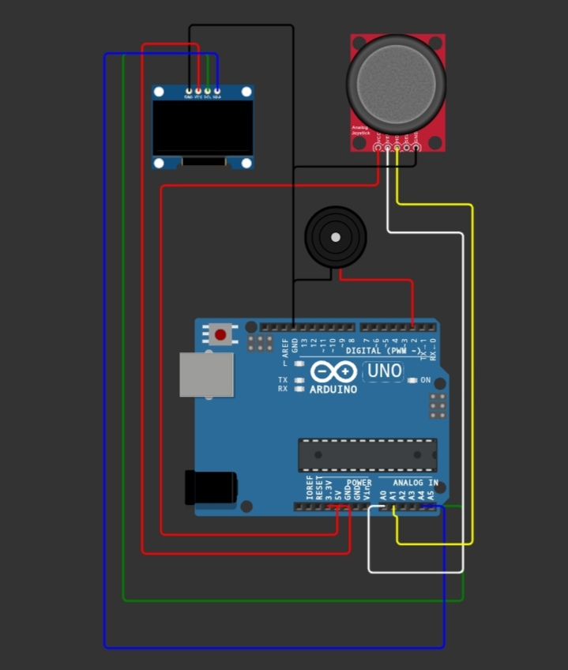

# Tennis Game on OLED

A tennis simulation for an OLED display with arcade-style gameplay and support for single-player or two-player controls.

## Demo

https://youtube.com/shorts/6r2cnTWWHZc?si=_V5N4E5UkueIsPQ5

## Hardware

- Arduino-compatible board
- SSD1306 128x64 I2C OLED
- One or two control inputs as defined by the sketch
- Optional buzzer

## Wiring

Connect the OLED to the board's I2C pins (SDA/SCL). Connect each controller to the input pins defined in `Source code`, with shared power and ground.

## Source

Open [`Source code`](./Source%20code) in the Arduino IDE, select the board and port, and upload.
