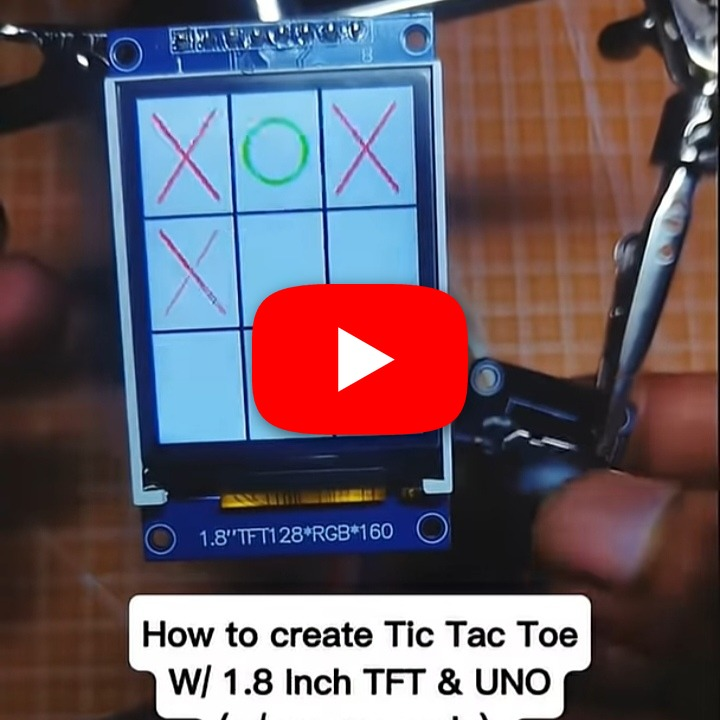

# Tic-Tac-Toe on Arduino UNO and TFT

An interactive Tic-Tac-Toe game for Arduino UNO with TFT display support.

## Demo

https://youtube.com/shorts/Tz-dND8D-6A?si=AbCoeuQl3rb565W7

## Hardware

- Arduino UNO
- TFT display
- Touch or control inputs supported by the sketch
- Jumper wires and suitable power connections

## Wiring

Connect the TFT display and input controls according to the pin definitions in `Tic tac toe Source code`. Confirm the display power, ground, and interface pins before powering the circuit.

## Source

Open [`Tic tac toe Source code`](./Tic%20tac%20toe%20Source%20code) in the Arduino IDE, select Arduino UNO and the correct port, and upload.
