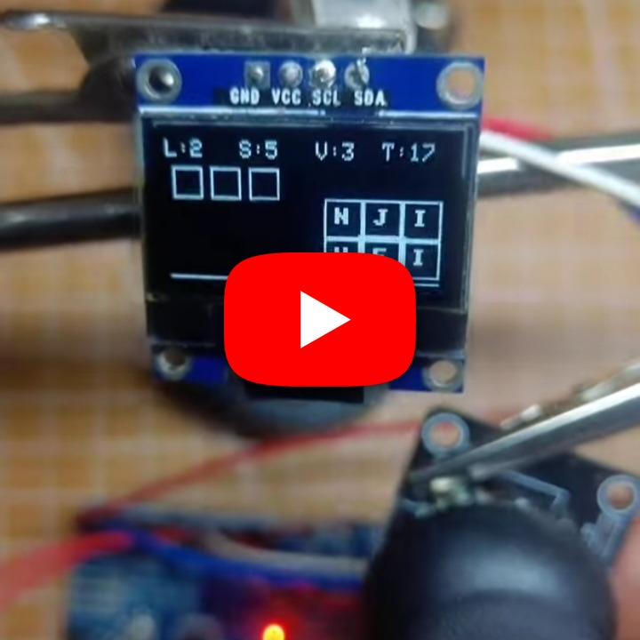

# Word Scramble

A word puzzle game for a microcontroller that challenges the player to unscramble letters.

## Demo

https://youtube.com/shorts/REPLACE_WITH_WORD_SCRAMBLE_VIDEO_ID

## Hardware

- Arduino-compatible or embedded board
- SSD1306 OLED display
- Input buttons or joystick supported by the sketch
- Optional buzzer

## Wiring

| Component | Pin |
|---|---|
| OLED SDA | board SDA |
| OLED SCL | board SCL |
| Input controls | As defined in sketch |
| Buzzer (optional) | 3 |

## Source

Open [`Source-code`](./Source-code) in the Arduino IDE, install any required libraries, select the board and port, and upload.
